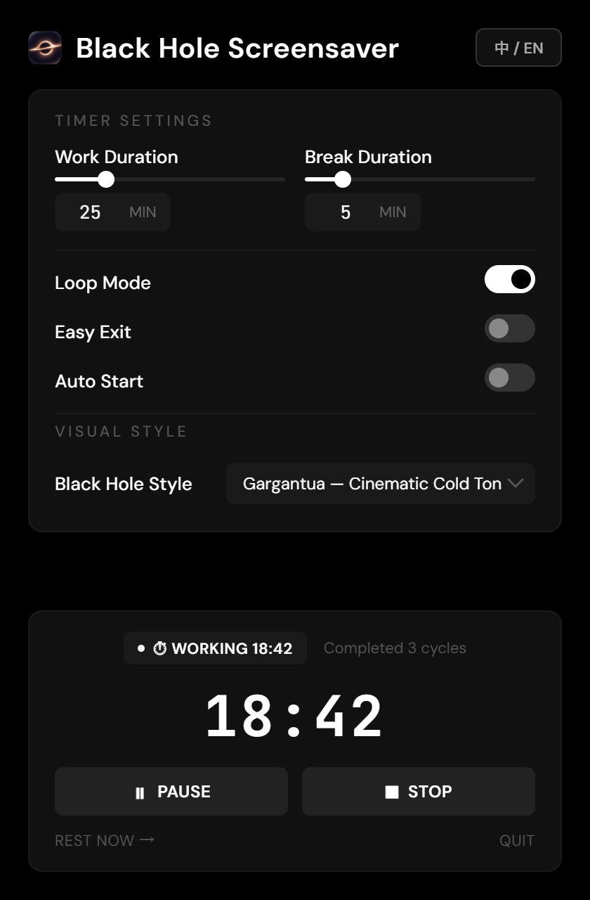

# Black Hole Screensaver

<p align="center"></p>

<p align="center"><b>A relativistic black hole screensaver and pomodoro break reminder for Windows</b><br>
A WebGL 2.0 black hole drawn over your live desktop, with a work/break timer, six visual presets and a tray-resident settings window.</p>

<p align="center"><a href="README_zh.md">中文说明</a></p>

When a break starts, the app captures the primary monitor and bends the desktop pixels around a Gargantua-style event horizon in real time. When the break is dismissed, the overlay closes and the capture is released. Work and break durations are configurable, completed cycles are counted, and the whole app lives in the notification area so it can stay open all day.

<p align="center"></p>

<p align="center"><i>The settings window: timer settings, visual style and the live status panel. Rendered from the real UI with sample data.</i></p>

## Features

| Area | What you get |
| --- | --- |
| Black hole rendering | A custom WebGL 2.0 fragment shader traces null geodesics: gravitational lensing, Keplerian disk velocities and relativistic Doppler beaming. Six presets are described below. |
| Desktop lensing | Each break captures the primary monitor and bends the desktop pixels around the event horizon in real time, then releases the capture when the overlay is dismissed. If the stream ends (lock/unlock, display change), the overlay re-acquires it or shows a visible hint instead of painting a stale frame. |
| Pomodoro timer | Configurable work and break durations, an idle state, an on-overlay break countdown and cycle tracking. |
| Fullscreen overlay | A focusable overlay with the break countdown, the exit prompt and the live desktop capture; it takes keyboard focus while visible so IME input works. |
| Minimalist monochrome UI | A stark dark settings window using DM Sans for text and JetBrains Mono for timer digits. |
| Exit confirmation | With Easy Exit off, the overlay requires typing `确认停止休息` (IME composition is supported); with Easy Exit on, any non-modifier key dismisses the break. |
| Tray-resident app | Closing the settings window hides it to the notification area and keeps the app running. Windows 11 files new tray icons in the `^` overflow, so the first hide shows a balloon explaining where the app went; a single left-click on the tray icon reopens the settings, the tray menu offers Show Settings / Break Now / Quit, and launching the app again reopens the running instance. If a tray icon cannot be created at all, closing the window minimizes it to the taskbar instead, so the app can never become unreachable. The `退出程序` link in the settings window and the tray menu `退出` are the explicit quit paths. |
| Portable folder and installer | `npm run pack` produces `dist/win-unpacked` with a single `Black Hole Screensaver.exe` (the Electron runtime) plus `启动 Black Hole 屏保.cmd` and `使用说明.txt`; `npm run dist` additionally builds the NSIS installer. The installer's shortcuts and the shipped start script launch the app through the signed `cmd.exe` with `cmd /d /c start`, so normal daily launches skip ShellExecute's SmartScreen reputation check *and* the app is detached from the console: cmd returns immediately and no stray console window stays behind. A direct first launch of the exe or installer still shows the Windows SmartScreen prompt (`更多信息` → `仍要运行`) because the binaries are unsigned; that prompt is not UAC and the app never needs administrator rights. |
| Auto start | Toggle Windows startup execution inside settings. The login item is only touched by packaged builds, so development runs never change it. |
| Multi-language | English (en-US) and Chinese (zh-CN) for the settings window and the screensaver exit/countdown UI; tray menu labels remain Chinese. |

The preset keys are `inferno`, `gargantua`, `m87`, `quasar`, `blazar` and `purelens`.

## Visual presets

| Preset | Look |
| --- | --- |
| Inferno (default) | 5500K warm accretion disk |
| Gargantua | Cinematic cold-toned disk |
| M87* Donut | Face-on radio-galaxy view |
| Quasar | 15000K blue-hot relativistic jet |
| Blazar | Extreme beaming alignment |
| Pure Lens | Pure gravity distortion with a starfield |

Presets are selected under Black Hole Style in the settings window and saved as the `preset` key.

## How it is built

- **Shell**: Electron 35+ with vanilla HTML, CSS and JavaScript renderers; no front-end framework.
- **Graphics**: WebGL 2.0 renders a fullscreen quad generated from `gl_VertexID`, driven by `renderer/blackhole.frag`; the renderer keeps a 1x1 placeholder desktop texture and only samples real frames when a capture is live.
- **Screensaver overlay**: `renderer/screensaver.js` owns the per-break desktop capture lifecycle, the focusable IME exit UI and the on-screen break countdown.
- **Timer engine**: a wall-clock delta-corrected `setInterval` loop in `timer.js`, so CPU scheduling drift does not accumulate.
- **Settings store**: a local JSON file in the app's userData directory; values are sanitised on load and save.

## Requirements

- Windows 10 or 11, x64. The app never needs administrator rights.
- Node.js (LTS recommended) only when you run or build it from source; the packaged app bundles its own Electron runtime.

## Run from source

```bash
npm install
npm run dev     # development mode
npm start       # production-like app
```

## Packaging

```bash
npm run pack    # portable folder: dist/win-unpacked
npm run dist    # the portable folder plus an NSIS installer
```

Both scripts run `scripts/fix-label.js` after electron-builder. It forces the build output to the *Medium* mandatory integrity level: a workspace folder created by a sandboxed agent session can carry an inheritable *Low* mandatory label, and every exe built inside it then runs at Low integrity. That breaks the app at startup (its userData is not writable, so the single-instance lock fails and Chromium's sandbox initialization aborts before `main.js`), and makes the NSIS installer unable to write its install directory (`无法关闭` or a silent no-op). See the troubleshooting notes below.

`build.extraFiles` copies `启动 Black Hole 屏保.cmd` and `使用说明.txt` next to the executable. `build/installer.nsh` recreates the Start Menu and desktop shortcuts through `cmd.exe` (signed) so normal shortcut launches do not go through ShellExecute's SmartScreen reputation check; the argument string is `/d /c start "" "<install>\Black Hole Screensaver.exe"` so cmd launches the app detached and exits instead of waiting for it.

The packaged app ships only runtime files (`build.files` in `package.json`): `main.js`, `preload.js`, `timer.js`, `renderer/**`, `assets/**` and `package.json`. Dev docs, screenshots, `original_shader.glsl` and `dist/` stay out of `app.asar`.

## Install and uninstall

- **Installer**: run `dist/Black Hole Screensaver Setup 1.0.1.exe`. The installer is unsigned, so the first launch shows the SmartScreen prompt (`更多信息` → `仍要运行`); it is not UAC and needs no administrator rights. It creates Start Menu and desktop shortcuts named `Black Hole 屏保`, which start the app through `cmd.exe /d /c start`; no console window is left running.
- **Portable**: copy `dist/win-unpacked` to any folder and start `启动 Black Hole 屏保.cmd`; the folder's `使用说明.txt` describes the same steps in Chinese.
- **Uninstall**: remove the app from Windows Settings → Apps, or delete the portable folder. Your settings in `%APPDATA%\blackhole-screensaver` stay unless you delete that folder yourself.

Do not add a "Run as administrator" compatibility flag: elevation does not remove the SmartScreen prompt, and the app never needs administrator rights.

## Troubleshooting

- **The Windows SmartScreen prompt (`Windows 已保护你的电脑`) appears on launch.** The exe and installer are unsigned; SmartScreen evaluates shell launches of unrecognized executables. This is **not** UAC and does not require administrator rights: click **更多信息 → 仍要运行**. Normal daily launches through the shipped shortcuts or `启动 Black Hole 屏保.cmd` do not show this prompt because they start the exe through `cmd.exe`.
- **A minimized `cmd` window sits in the background while the app runs, and closing it also quits the app.** That is cmd.exe waiting for the app, not the app itself. `cmd /c "app.exe"` runs the exe as a child of cmd, and cmd.exe *waits* for 64-bit GUI programs, so its (minimized) console window lives as long as the app; closing that console sends `CTRL_CLOSE_EVENT` to the processes bound to it and terminates the app. Shortcuts built from this source use `cmd /d /c start "" "app.exe"` instead: `start` hands the exe to Windows as a detached process, cmd exits within milliseconds and no console window exists to close. Reinstall the app (or regenerate `启动 Black Hole 屏保.cmd` with `npm run pack`) if an older build still shows the stray window.
- **The app exits immediately on a normal (non-elevated) launch — no window, no tray icon, no `startup.log` entries.** Check the exe's mandatory integrity label: `icacls "dist\win-unpacked\Black Hole Screensaver.exe"` must not list `Mandatory Label\Low Mandatory Level`. A Low label makes Windows start the process at Low integrity, so it cannot write `%APPDATA%\blackhole-screensaver`; Electron's single-instance lock and Chromium's sandbox initialization then fail and the process dies before `main.js` runs (an elevated launch "works" only because it raises the integrity level, and a procdump capture shows `STATUS_ILLEGAL_INSTRUCTION` / `IMMEDIATE_CRASH`). Fix the labels with `icacls "<folder>" /setintegritylevel Medium /T` — no administrator rights are needed when you own the files — and rebuild via `npm run pack` or `npm run dist`, which run `scripts/fix-label.js` automatically. A Low label on the installer produces the same class of install failures.
- **Closing the settings window appears to fully close the app.** Close hides it to the notification area and the process keeps running; the first hide shows a balloon explaining this. Reopen it by left-clicking the tray icon, by launching the app again (a second instance forwards to the running one), or through the desktop or taskbar shortcut. The tray menu `退出` and the `退出程序` link quit the app.
- **The tray icon is missing on Windows 11.** New notification-area icons are placed in the `^` overflow by default. Click `^` and drag the Black Hole icon onto the notification area to keep it visible. The app logs `tray-in-overflow` in `startup.log` when the shell reports the icon in the overflow. If tray creation failed entirely (`tray-failed` in `startup.log`), closing the settings window minimizes it to the taskbar instead.
- **The installer says the app cannot be closed, or fails writing the uninstaller.** Quit the running app first: tray icon → `退出` (or the `退出程序` link in the settings window), then run the installer again. If it still fails, check that neither the installer nor the packaged exe carries a Low mandatory integrity label (see the startup note above); an elevated app instance cannot be closed by a non-elevated installer, so avoid "Run as administrator" launches too. If a previous installation is half-broken, remove `%LOCALAPPDATA%\Programs\blackhole-screensaver` before reinstalling.
- **Debugging a silent startup failure.** Check `startup.log` in the app's `userData` directory (normally `%APPDATA%\blackhole-screensaver`, or the writable fallback picked at startup), plus `crash.log`, and `icacls <exe>` for a `Low Mandatory Level` line. Early Electron/Chromium errors are printed to stderr when launched from a console.
- **When testing from an Electron-based agent shell**, clear `ELECTRON_RUN_AS_NODE` before launching the packaged exe (otherwise it runs as plain Node and exits), and remember that in-process `ShellExecute` wrappers inherit the agent's restricted token.

## Configuration (`settings.json`)

Your settings are persisted in `settings.json` in the Electron app's `userData` path:

```json
{
  "workMinutes": 25,
  "breakMinutes": 5,
  "loop": true,
  "easyExit": false,
  "preset": "inferno",
  "autoStart": false,
  "language": "zh-CN"
}
```

If the roaming `userData` directory is not writable (packaged or sandboxed launch, broken ACLs), the app probes and switches to the first writable fallback in this order: `%TEMP%\blackhole-screensaver`, `%LOCALAPPDATA%\blackhole-screensaver`, a `userdata` folder next to the executable, then `./userdata`. Existing settings are migrated to the chosen directory and its path is written to `startup.log`. This avoids the silent exit caused by Electron failing to create its single-instance lock file.

- **`workMinutes`**: length of a work session in minutes.
- **`breakMinutes`**: length of a screensaver break session in minutes.
- **`loop`**: automatically restart work sessions after a break is dismissed or concludes.
- **`easyExit`**: if `true`, any non-modifier key dismisses the screensaver; if `false`, the overlay takes keyboard focus and requires typing the IME characters `确认停止休息`.
- **`preset`**: shader style selection (`inferno` | `gargantua` | `m87` | `quasar` | `blazar` | `purelens`).
- **`autoStart`**: register the application to run at OS login; applied only by packaged builds.
- **`language`**: UI language (`zh-CN` | `en-US`).

## Global hotkeys

- **`Ctrl+Q` or `Cmd+Q`**: abort an active break immediately. The overlay is dismissed and the timer returns to idle; it does **not** start a new work session. This shortcut is registered only while the screensaver is visible.
- **`Ctrl+Alt+Q`**: fallback abort shortcut, used automatically when `Ctrl+Q` cannot be registered.
- The overlay takes keyboard focus while a break is shown, so the IME confirmation and any-key exit work; the global shortcut remains the fallback. A normal dismissal (any key or IME) starts the next work countdown when Loop Mode is enabled, while the abort shortcut always returns to idle.

## Structure

```
main.js                  Electron main process: windows, tray, timer wiring, shortcuts, settings store
preload.js               contextBridge API between the main process and the renderers
timer.js                 Wall-clock delta-corrected pomodoro state machine
renderer/settings.*      Settings window (HTML, CSS, JS) and locales.js for en-US / zh-CN
renderer/screensaver.*   Fullscreen overlay, per-break desktop capture, IME exit UI, countdown
renderer/blackhole.frag  Relativistic fragment shader with the six presets
renderer/blackhole-renderer.js  WebGL 2.0 renderer: uniforms, desktop texture, render loop
assets/                  App icon, settings-header icon and tray icon
build/                   NSIS config, portable start script, 使用说明, icon artwork and master
scripts/                 fix-label.js (integrity labels), build-icon.py (icon pipeline)
test/timer.test.js       Timer state-machine tests (node --test)
docs/images/             README screenshots
```

## Development

```bash
npm test        # node --test test/timer.test.js
```

The timer state machine is covered by `test/timer.test.js` using Node's built-in test runner and mocked timers. The tests are dependency-free; run them before changing timer semantics.

The icon set is generated from `build/icon-source.png` by `scripts/build-icon.py` (Python 3 with numpy and Pillow). Rerun it after changing the artwork; do not hand-edit the PNGs.

## License

This project is open-source. Feel free to use, modify and build upon it.
