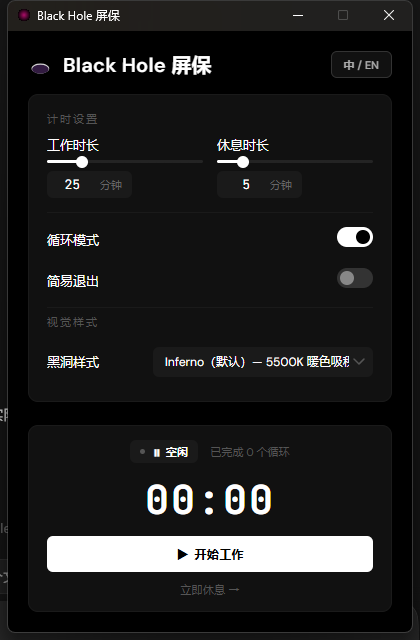
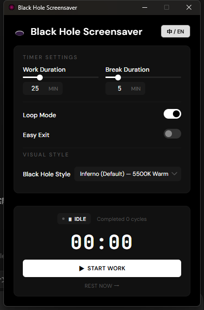

# Black Hole Screensaver (黑洞番茄钟屏保)

A premium, minimalist desktop screensaver and work-break reminder built with **Electron**, **WebGL 2.0**, and **HTML5/CSS3/Vanilla JS**. 

This is a Windows remake of [s0xDk/ghostty-blackhole](https://github.com/s0xDk/ghostty-blackhole), adapting the black-hole visual idea into a standalone Windows screensaver and Pomodoro break reminder.

It simulates a highly realistic black hole using relativistic physics (geodesic tracing, Doppler beaming, gravitational lensing) directly overlaying your desktop. The screensaver acts as a tomato timer (pomodoro) break screen, encouraging healthy work intervals.

---

## Screenshots

### Chinese UI



### English UI



---

## 🌟 Features

- **Relativistic Black Hole Simulation**: Custom WebGL 2.0 fragment shader calculating gravitational lensing, Keplerian disk velocities, and Doppler beaming.
- **Desktop Grabbing & Lensing**: Dynamically captures your primary monitor and bends the desktop pixels around the event horizon in real time using smooth alpha mask blending.
- **Pomodoro Break Reminder**: Configurable work/break durations with an idle state, countdowns, and cycle tracking.
- **Visual Styles & Presets**: Choose from 6 stunning styles:
  1. **Inferno (Default)**: 5500K warm accretion disk.
  2. **Gargantua**: Cinematic cold-toned disk.
  3. **M87* Donut**: Face-on radio galaxy view.
  4. **Quasar**: 15000K blue-hot relativistic jet.
  5. **Blazar**: Extreme beaming alignment.
  6. **Pure Lens**: pure gravity distortion + starfield background.
- **Minimalist Monochrome UI**: Configured with a stark dark mode UI using **DM Sans** and **JetBrains Mono** typography.
- **IME Dismissal Confirmation (Optional)**: Prevents accidental break exits by forcing users to type "确认停止休息" (Confirm Stop Resting) using their IME.
- **System Tray Integration**: Quietly runs in the background. Hide to tray, double-click to configure, or invoke break manually.
- **Auto-Start**: Easily toggle Windows startup execution inside settings.
- **Multi-language Support**: Complete English (en-US) and Chinese (zh-CN) localization.

---

## 🛠️ Technology Stack & Architecture

- **Shell / Runtime**: Electron (v35+)
- **Graphics**: WebGL 2.0 (OpenGL ES 3.0) rendering a full-screen quad driven by `gl_VertexID`
- **Timer Engine**: Wall-clock delta-corrected `setInterval` loop in Node.js to eliminate system CPU scheduling drift
- **Settings Store**: Local JSON storage persisted under the user app data directory

---

## 🚀 Getting Started

### Prerequisites

Make sure you have [Node.js](https://nodejs.org/) installed (LTS recommended).

### Installation

1. Clone or download this repository.
2. Install dependencies:
   ```bash
   npm install
   ```

### Running Locally

To launch the application in development mode with DevTools enabled:
```bash
npm run dev
```
To run the normal production-like app:
```bash
npm start
```

### Packaging & Distribution

To package the app as a standalone Windows installer (or portable unpackaged folder under `dist/`):
```bash
# Package win-unpacked version
npm run pack

# Or build full setups and installers
npm run dist
```

---

## ⚙️ Configuration File (`settings.json`)

Your settings are persisted in `settings.json` in the Electron app's `userData` path:
```json
{
  "workMinutes": 25,
  "breakMinutes": 5,
  "loop": true,
  "easyExit": false,
  "preset": "inferno",
  "autoStart": false,
  "language": "zh-CN"
}
```

- **`workMinutes`**: Length of work session in minutes.
- **`breakMinutes`**: Length of screensaver break session in minutes.
- **`loop`**: Automatically restart work sessions after a break concludes.
- **`easyExit`**: If `true`, pressing any key dismisses the screensaver. If `false`, requires typing the IME characters.
- **`preset`**: Key representing shader style selection (`inferno` | `gargantua` | `m87` | `quasar` | `blazar` | `purelens`).
- **`autoStart`**: Register application to run at OS login.

---

## ⌨️ Global Hotkeys

- **`Ctrl+Q` or `Cmd+Q`**: Emergency exit shortcut when screensaver is active. Dismisses overlay and stops the current timer immediately.

---

## 📄 License

This project is open-source. Feel free to use, modify, and build upon it.
