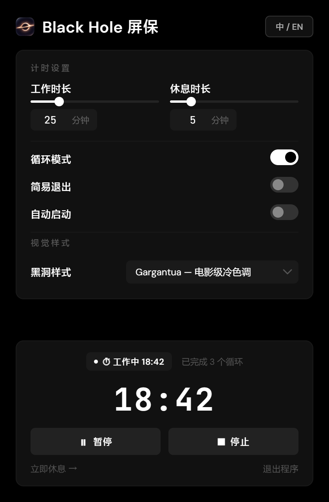

# Black Hole Screensaver · 相对论黑洞番茄钟屏保

<p align="center"></p>

<p align="center"><b>Windows 上的相对论黑洞屏保与番茄工作休息提醒</b><br>
用 WebGL 2.0 把黑洞画在实时桌面上，内置工作/休息计时、6 种视觉预设和常驻托盘的设置窗口。</p>

<p align="center"><a href="README.md">English README</a></p>

每次休息开始时，应用捕获主显示器，实时把桌面像素绕事件视界弯曲；休息结束时关闭浮层并释放捕获。工作时长与休息时长可配置，会统计完成的循环数，整个应用常驻通知区域，可以整天开着。

<p align="center"></p>

<p align="center"><i>设置窗口：计时设置、视觉样式与实时状态面板。截图由真实 UI 配合示例数据渲染。</i></p>

## 功能

| 位置 | 用法 |
| --- | --- |
| 黑洞渲染 | 自定义 WebGL 2.0 片元着色器追踪零测地线，计算引力透镜、开普勒吸积盘速度与相对论多普勒光束效应。内置 6 种预设，见下文。 |
| 桌面透镜 | 每次休息开始时捕获主显示器，实时把桌面像素绕事件视界弯曲，浮层关闭时释放捕获。如果媒体流中断（锁屏/解锁、显示器变化），浮层会重新获取画面，或显示可见提示，而不会继续绘制过期的画面。 |
| 番茄计时 | 可配置的工作/休息时长，包含空闲状态、浮层上的休息倒计时以及循环次数统计。 |
| 全屏浮层 | 带休息倒计时、退出提示与实时桌面捕获的可聚焦浮层；显示期间会获取键盘焦点，因此输入法可以正常工作。 |
| 极简单色界面 | 暗色设置窗口，正文使用 DM Sans，计时数字使用 JetBrains Mono。 |
| 退出确认 | 关闭简易退出时，浮层要求输入 `确认停止休息`（支持输入法组合输入）；开启简易退出后，按任意非修饰键即可关闭休息画面。 |
| 托盘驻留 | 关闭设置窗口会将其隐藏到通知区域，应用继续运行。Windows 11 会把新的托盘图标放进 `^` 溢出区，因此首次隐藏时会弹出气泡说明应用去了哪里；单击托盘图标即可重新打开设置，托盘菜单提供「显示设置 / 立即休息 / 退出」，再次启动应用也会重新打开正在运行的实例。如果托盘图标完全无法创建，关闭窗口时会改为最小化到任务栏，因此应用绝不会变得无法访问。设置窗口中的 `退出程序` 链接和托盘菜单中的 `退出` 是明确的退出路径。 |
| 便携文件夹与安装程序 | `npm run pack` 会生成 `dist/win-unpacked`，其中包含 `Black Hole Screensaver.exe`（Electron 运行时）以及 `启动 Black Hole 屏保.cmd` 和 `使用说明.txt`；`npm run dist` 还会额外构建 NSIS 安装程序。安装程序的快捷方式和随附的启动脚本都通过已签名的 `cmd.exe`（`cmd /d /c start`）启动应用，因此日常启动既会跳过 ShellExecute 的 SmartScreen 信誉检查，也不会残留 cmd 控制台窗口：cmd 启动后立即退出，应用是被 `start` 交给系统独立启动的。首次直接运行 exe 或安装程序时，由于二进制文件未签名，仍会出现「Windows 已保护你的电脑」SmartScreen 提示（`更多信息` → `仍要运行`）；该提示不是 UAC，应用始终不需要管理员权限。 |
| 自动启动 | 可在设置中开关是否随 Windows 启动。只有打包版本才会改动登录项，因此开发运行永远不会改变它。 |
| 多语言 | 设置窗口以及屏保退出/倒计时界面支持英文（en-US）和中文（zh-CN）；托盘菜单标签保持中文。 |

预设键为 `inferno`、`gargantua`、`m87`、`quasar`、`blazar` 和 `purelens`。

## 视觉预设

| 预设 | 效果 |
| --- | --- |
| Inferno（默认） | 5500K 暖色吸积盘 |
| Gargantua | 电影级冷色调吸积盘 |
| M87* Donut | 正面视角的射电星系 |
| Quasar | 15000K 蓝热相对论喷流 |
| Blazar | 极端束射 |
| Pure Lens | 纯引力透镜 + 星空背景 |

在设置窗口的「黑洞样式」中选择，保存为 `preset` 键。

## 技术实现

- **外壳**：Electron 35+，渲染层为原生 HTML、CSS 与 JavaScript，不使用前端框架。
- **图形**：WebGL 2.0 通过 `gl_VertexID` 生成全屏四边形，由 `renderer/blackhole.frag` 驱动；渲染器始终绑定 1x1 占位桌面纹理，只有捕获到真实帧时才采样。
- **屏保浮层**：`renderer/screensaver.js` 负责每次休息的桌面捕获生命周期、可聚焦的输入法退出界面以及屏幕上的休息倒计时。
- **计时引擎**：`timer.js` 中基于实际时间（wall clock）增量校正的 `setInterval` 循环，避免 CPU 调度漂移累积。
- **设置存储**：应用 userData 目录下的本地 JSON 文件，加载和保存时都会规范取值。

## 环境要求

- Windows 10/11 x64；应用不需要管理员权限。
- 只有从源码运行或构建时才需要 Node.js（建议 LTS 版本）；打包后的应用自带 Electron 运行时。

## 从源码运行

```bash
npm install
npm run dev     # development mode
npm start       # production-like app
```

## 打包

```bash
npm run pack    # portable folder: dist/win-unpacked
npm run dist    # the portable folder plus an NSIS installer
```

两个脚本都会在 electron-builder 之后运行 `scripts/fix-label.js`。该步骤会把构建产物强制设为 *Medium*（中）强制完整性级别：由沙箱化的 agent 会话创建的工作区文件夹可能带有可继承的 *Low*（低）强制标签，于是其中构建出的每个 exe 都会以低完整性运行。这会使应用启动失败（它的 userData 不可写，单实例锁创建失败，Chromium 的沙箱初始化在 `main.js` 运行之前就中止），也会让 NSIS 安装程序无法写入安装目录（`无法关闭` 或静默无操作）。请参阅下方的故障排查说明。

`build.extraFiles` 会把 `启动 Black Hole 屏保.cmd` 和 `使用说明.txt` 复制到可执行文件旁边。`build/installer.nsh` 通过（已签名的）`cmd.exe` 重建开始菜单与桌面快捷方式，因此通过常规快捷方式启动时不会经过 ShellExecute 的 SmartScreen 信誉检查；参数串是 `/d /c start "" "<安装目录>\Black Hole Screensaver.exe"`，cmd 只负责把应用交给系统启动，随后立即退出，不会等待应用。

打包后的应用只包含运行时文件（`package.json` 中的 `build.files`）：`main.js`、`preload.js`、`timer.js`、`renderer/**`、`assets/**` 和 `package.json`。开发文档、截图、`original_shader.glsl` 与 `dist/` 不会被打进 `app.asar`。

## 安装与卸载

- **安装程序**：运行 `dist/Black Hole Screensaver Setup 1.0.1.exe`。安装程序未签名，首次启动会出现 SmartScreen 提示（`更多信息` → `仍要运行`）；它不是 UAC，也不需要管理员权限。安装程序会创建名为 `Black Hole 屏保` 的开始菜单与桌面快捷方式，通过 `cmd.exe /d /c start` 启动应用，不会残留控制台窗口。
- **便携版**：把 `dist/win-unpacked` 复制到任意文件夹，运行 `启动 Black Hole 屏保.cmd`；文件夹里的 `使用说明.txt` 用中文描述了同样的步骤。
- **卸载**：在 Windows 设置 → 应用中移除，或直接删除便携文件夹。`%APPDATA%\blackhole-screensaver` 中的设置会保留，除非你手动删除该目录。

不要添加「以管理员身份运行」兼容性标记：提权并不能消除 SmartScreen 提示，而且应用始终不需要管理员权限。

## 故障排查

- **启动时出现 `Windows 已保护你的电脑`（SmartScreen）。** exe 与安装程序未签名，SmartScreen 会评估通过 shell 启动的无法识别的可执行文件。这**不是** UAC，也不需要管理员权限：点击 `更多信息` → `仍要运行` 即可。通过随附快捷方式或 `启动 Black Hole 屏保.cmd` 的日常启动不会出现该提示，因为它们通过 `cmd.exe` 启动 exe。
- **后台常驻一个最小化的 `cmd` 窗口，把它关掉应用也会退出。** 那个窗口是 cmd.exe 在等应用退出，不是应用自己的窗口。`cmd /c "app.exe"` 把 exe 当成 cmd 的子进程运行，而 cmd.exe 对 64 位 GUI 程序**会等待**，所以它（最小化的）控制台窗口会和应用同寿；关闭该控制台会向绑定在其上的进程发送 `CTRL_CLOSE_EVENT`，应用随之被杀。本仓库构建的快捷方式已改用 `cmd /d /c start "" "app.exe"`：`start` 让系统以独立进程启动 exe，cmd 在毫秒级内退出，不存在可关闭的控制台窗口。如果旧版本仍出现该窗口，重新安装，或用 `npm run pack` 重新生成 `启动 Black Hole 屏保.cmd`。
- **应用在普通（非提权）启动后立即退出——没有窗口、没有托盘图标、`startup.log` 中也没有任何记录。** 检查 exe 的强制完整性标签：`icacls "dist\win-unpacked\Black Hole Screensaver.exe"` 的输出中不得列出 `Mandatory Label\Low Mandatory Level`。Low 标签会让 Windows 以低完整性启动该进程，因此它无法写入 `%APPDATA%\blackhole-screensaver`；随后 Electron 的单实例锁与 Chromium 的沙箱初始化都会失败，进程在 `main.js` 运行之前就退出（提权启动之所以「可用」，只是因为它提升了完整性级别；用 procdump 捕获会看到 `STATUS_ILLEGAL_INSTRUCTION` / `IMMEDIATE_CRASH`）。用 `icacls "<folder>" /setintegritylevel Medium /T` 修复标签——当你拥有这些文件时不需要管理员权限——然后通过 `npm run pack` 或 `npm run dist` 重新构建，这两个脚本会自动运行 `scripts/fix-label.js`。安装程序带有 Low 标签时，会产生同一类安装失败。
- **关闭设置窗口看起来像是应用被完全关闭了。** 关闭操作只是把窗口隐藏到通知区域，进程仍在运行；首次隐藏时会弹出气泡说明这一点。可以通过单击托盘图标、再次启动应用（第二个实例会转发给正在运行的实例），或使用桌面/任务栏快捷方式重新打开。托盘菜单的 `退出` 与设置窗口中的 `退出程序` 链接会退出应用。
- **在 Windows 11 上找不到托盘图标。** 新的通知区域图标默认被放入 `^` 溢出区。点击 `^` 并把 Black Hole 图标拖到通知区域上即可让它保持可见。当系统外壳报告图标位于溢出区时，应用会在 `startup.log` 中记录 `tray-in-overflow`。如果托盘创建完全失败（`startup.log` 中的 `tray-failed`），关闭设置窗口时会改为最小化到任务栏。
- **安装程序提示无法关闭应用，或写入卸载程序失败。** 请先退出正在运行的应用：托盘图标 → `退出`（或设置窗口中的 `退出程序` 链接），然后重新运行安装程序。如果仍然失败，请检查安装程序与打包后的 exe 是否都没有 Low 强制完整性标签（参见上面的启动说明）；非提权的安装程序无法关闭以提权方式运行的应用实例，因此也要避免「以管理员身份运行」启动。如果上一次安装已处于半损坏状态，请在重新安装前删除 `%LOCALAPPDATA%\Programs\blackhole-screensaver`。
- **调试静默启动失败。** 检查应用的 `userData` 目录（通常为 `%APPDATA%\blackhole-screensaver`；当漫游配置文件不可写时，为启动时选定的可写回退目录）中的 `startup.log`，以及 `crash.log`，并用 `icacls <exe>` 检查是否出现 `Low Mandatory Level` 行。从控制台启动时，早期的 Electron/Chromium 错误会打印到 stderr。
- **在基于 Electron 的 agent shell 中测试时**，启动打包后的 exe 前请清除 `ELECTRON_RUN_AS_NODE`（否则它会以普通 Node 运行并退出），并记住进程内的 `ShellExecute` 封装会继承 agent shell 的受限令牌。

## 配置文件（`settings.json`）

设置会持久化在 Electron 应用 `userData` 路径下的 `settings.json` 中：

```json
{
  "workMinutes": 25,
  "breakMinutes": 5,
  "loop": true,
  "easyExit": false,
  "preset": "inferno",
  "autoStart": false,
  "language": "zh-CN"
}
```

如果漫游 `userData` 目录不可写（打包或沙箱化启动、ACL 损坏），应用会按以下顺序探测并切换到第一个可写回退目录：`%TEMP%\blackhole-screensaver`、`%LOCALAPPDATA%\blackhole-screensaver`、可执行文件旁边的 `userdata` 文件夹，最后是 `./userdata`。现有设置会被迁移到所选目录，该目录路径会写入 `startup.log`。这避免了因 Electron 无法创建单实例锁文件而导致的静默退出。

- **`workMinutes`**：工作时长（分钟）。
- **`breakMinutes`**：屏保休息时长（分钟）。
- **`loop`**：休息被关闭或结束后自动重新开始工作会话。
- **`easyExit`**：为 `true` 时，按任意非修饰键即可关闭屏保；为 `false` 时，浮层会获取键盘焦点，并要求键入输入法字符 `确认停止休息`。
- **`preset`**：表示着色器样式选择的键（`inferno` | `gargantua` | `m87` | `quasar` | `blazar` | `purelens`）。
- **`autoStart`**：注册应用在操作系统登录时运行，仅对打包版本生效。
- **`language`**：界面语言（`zh-CN` | `en-US`）。

## 全局快捷键

- **`Ctrl+Q` 或 `Cmd+Q`**：立即中止正在进行的休息。浮层关闭，计时器返回空闲状态；它**不会**开始新的工作会话。该快捷键仅在屏保可见时注册。
- **`Ctrl+Alt+Q`**：备用中止快捷键，在 `Ctrl+Q` 无法注册时自动启用。
- 休息显示期间，浮层会获取键盘焦点，以便输入法确认和任意键退出正常工作；全局快捷键仍是后备方式。启用循环模式时，正常关闭（任意键或输入法确认）会开始下一段工作倒计时，而中止快捷键始终返回空闲状态。

## 目录结构

```
main.js                  Electron 主进程：窗口、托盘、计时器接线、快捷键、设置存储
preload.js               主进程与渲染层之间的 contextBridge API
timer.js                 基于实际时间增量校正的番茄计时状态机
renderer/settings.*      设置窗口（HTML、CSS、JS）以及 en-US / zh-CN 的 locales.js
renderer/screensaver.*   全屏浮层、每次休息的桌面捕获、输入法退出界面、倒计时
renderer/blackhole.frag  相对论片元着色器与 6 种预设
renderer/blackhole-renderer.js  WebGL 2.0 渲染器：uniform、桌面纹理、渲染循环
assets/                  应用图标、设置页标题图标与托盘图标
build/                   NSIS 配置、便携启动脚本、使用说明、图标原图与母版
scripts/                 fix-label.js（完整性标签）、build-icon.py（图标生成）
test/timer.test.js       计时状态机测试（node --test）
docs/images/             README 截图
```

## 开发

```bash
npm test        # node --test test/timer.test.js
```

计时器状态机由 `test/timer.test.js` 使用 Node 内置的测试运行器与模拟计时器覆盖，测试不依赖第三方库；修改计时语义前请先运行它们。

图标由 `scripts/build-icon.py`（Python 3 + numpy、Pillow）从 `build/icon-source.png` 生成。更换原图后重新运行该脚本即可，不要手工修改 PNG。

## 许可证

本项目为开源项目，欢迎自由使用、修改并在此基础上构建。
